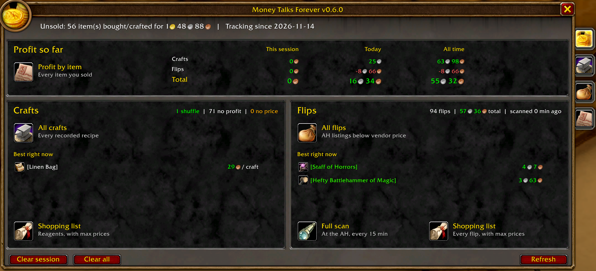
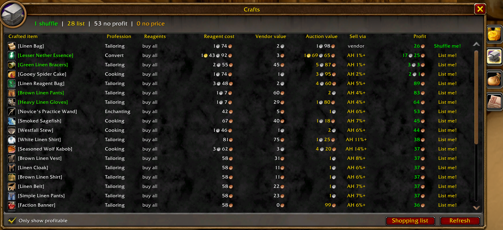
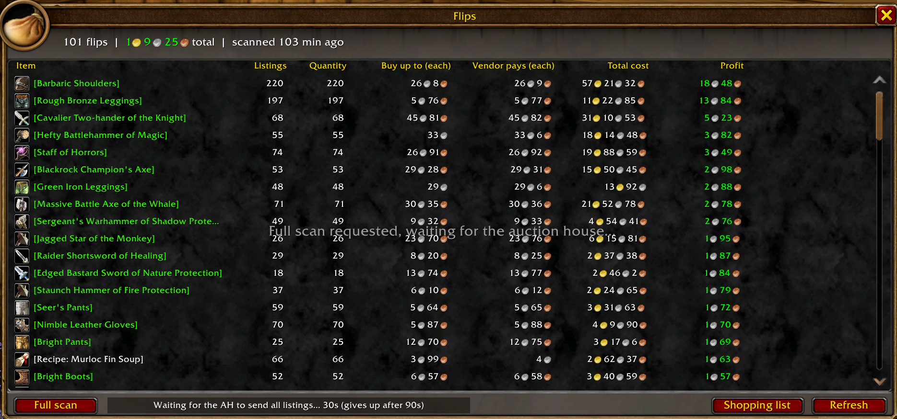
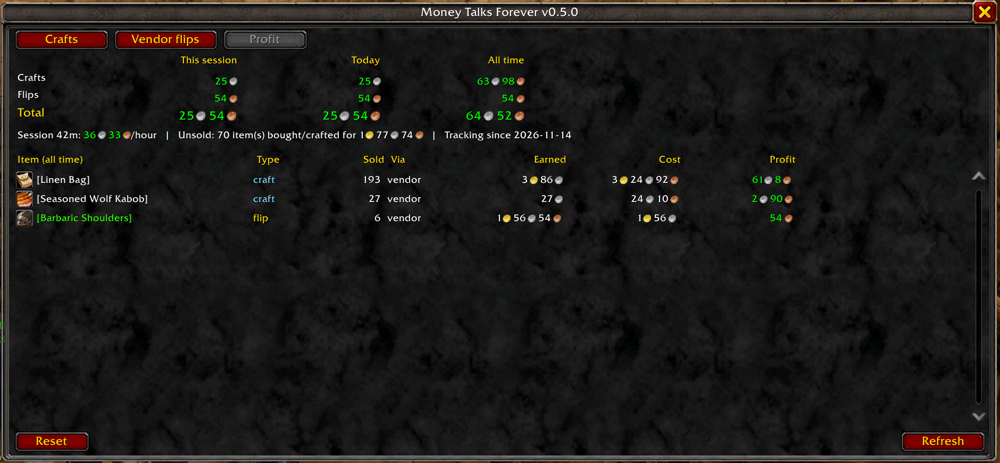

# Money Talks Forever

A World of Warcraft: Forever addon for making gold, using Auctionator's prices:

- **Crafts:** flags craftable items as **"Shuffle me!"** when their reagents cost less on the Auction House
  than the crafted item sells for to a vendor, or **"List me!"** when it only profits on the AH. It shows a
  step-by-step buy and craft plan, and creates a shopping list with the most you can pay per reagent.
- **Conversions:** right-click conversions anyone can do (3 lesser <-> 1 greater enchanting essence) are priced like
  recipes, both for AH arbitrage and as a cheaper way to get reagents.
- **Flips:** finds AH listings priced below what a vendor pays for them.
- **AH or vendor:** tells you when listing on the AH beats vendoring, deposit risk included.
- **Profit so far:** tracks what you actually paid and earned from crafts, flips and AH sales, per session, day and
  all time.

## Screenshots

**Overview:** profit so far this session, today and all time, and the best crafts and flips right now. The icons
on the right switch tabs.



**Crafts:** every recorded recipe and conversion with reagent cost, vendor and auction value, and the verdict:
"Shuffle me!" to sell to a vendor, "List me!" to sell on the AH.



**Flips:** AH listings you can buy and sell to a vendor for a profit, here with a full scan in progress.



**Profit:** every item you sold, how, and what it made.



## How crafts work

1. Open each of your profession windows once. Money Talks Forever records every learned recipe that produces an item,
   along with its required reagents. This is saved per character, so you don't need to reopen the window afterwards.
2. Run a full Auctionator scan at the Auction House.
3. For each recipe:
   - Crafted items that are soulbound (Bind on Pickup, quest, account-bound) are skipped. Bind on Equip, Bind on Use
     and unbound items are kept.
   - **Reagent cost** = sum over required reagents of `quantity x cheapest unit price`, where the unit price is the
     Auctionator AH price or, if Auctionator has seen it at a merchant and it is cheaper, the NPC vendor price.
     If you know a recipe that makes the reagent itself (e.g. Bolt of Linen Cloth from Linen Cloth), its craft cost
     (reagent cost / quantity made, resolved recursively) is used instead when that is cheaper than buying.
     Optional or finishing reagents are ignored. If a slot accepts several items (e.g. quality ranks), the cheapest
     one is used.
   - **Vendor value** = item vendor sell price x guaranteed minimum output quantity.
   - **Auction value** = Auctionator price of the crafted item x the same quantity. It is shown in gold when selling
     on the AH, after the 5% AH cut, beats vendoring. The row tooltip shows the profit for both ways of selling.
   - If `vendor value - reagent cost` is at least your minimum profit, the item is flagged **Shuffle me!**: a sure
     sale to any vendor.
   - Otherwise, if `auction value after the 5% cut - reagent cost` is, it is flagged **List me!**: profitable if it
     sells on the AH. **Sell via** shows how often it must sell for listing to beat vendoring, deposit included.
   - **Profit** is the profit of the flagged way of selling; for unprofitable rows, the better of the two.
   - A reagent is never made from the item being crafted, e.g. no Greater essence from Lesser ones split from a
     Greater.

### Conversions

Some items turn into others when you right-click them, no profession needed: 1 Greater Magic Essence splits into 3
Lesser, and 3 Lesser combine into 1 Greater (also Astral, Mystic, Nether and Eternal essences). Every character
knows these, so they are listed in the Crafts tab as profession **Convert**:

- **Arbitrage:** e.g. Greater at 3s 73c and Lesser at 1s 50c: split and list the 3 Lesser for 4s 27c after the cut,
  **List me!** for 54c. At 1s 30c it's a loss (3s 70c after the cut), and the row says so.
- **Cheaper reagents:** a recipe that needs a Greater essence is priced with 3 Lesser combined when that's cheaper,
  and its plan says so.
- **Profit tracking:** right-clicking the item is recorded like a craft, so the essences you get carry the cost of
  the ones you used.

Prices are re-evaluated automatically whenever Auctionator finishes a scan.

## Install

Download `MoneyTalksForever-vX.Y.Z.zip` from [Releases](https://github.com/regul4rj0hn/money-talks-forever/releases)
and extract it into `World of Warcraft\_forever_\Interface\AddOns\`. The zip contains the `MoneyTalksForever`
folder. To try an older or newer version, replace that folder with the one from another release; your saved data is
kept. Or copy the `MoneyTalksForever` folder from this repo. Requires
[Auctionator](https://www.curseforge.com/wow/addons/auctionator).

## Usage

| Command | Effect |
|---|---|
| `/mtf` | Toggle the window (hover a row for the reagent breakdown, shift-click to link) |
| `/mtf list` | Print every "Shuffle me!" and "List me!" item to chat |
| `/mtf vendor` | Toggle using NPC vendor prices for reagents (default on) |
| `/mtf craft` | Toggle pricing craftable reagents at their own craft cost when cheaper (default on) |
| `/mtf soulbound` | Toggle including soulbound crafts (default off) |
| `/mtf minprofit <gold>` | Minimum profit per craft to be flagged, e.g. `0.5` = 50s |
| `/mtf shop` | Create the Auctionator shopping list `Money Talks Forever` with max prices (same as the **Shopping list** button) |
| `/mtf flips` | Open the Flips tab (AH listings cheaper than their vendor price) |
| `/mtf profit` | Open the Profit tab; `/mtf profit session` clears this session, `/mtf profit reset` clears this character's profit history |
| `/mtf fullscan` | Full AH scan for flips (at the AH, once per 15 minutes) |
| `/mtf debug` | Print diagnostic info (scan state, Auctionator settings, counts) |
| `/mtf flipmin <gold>` | Minimum profit per flip listing, e.g. `0.01` = 1s |
| `/mtf duration 12\|24\|48` | Auction duration used for deposits (default 12h) |
| `/mtf reset` | Forget this character's recorded recipes |

The **Reagents** column shows `buy all` when every reagent should be bought, `buy + craft` when it is cheaper to
craft some reagents yourself first, or `split` / `combine` for conversions. Hover a row for the step-by-step plan:

```
1. Buy:
    6x Linen Cloth                 120c (AH)
2. Make, in this order:
    3x Bolt of Linen Cloth
    1x Linen Shirt
3. Sell 1x Linen Shirt to a vendor
Craftable reagents             buy / craft each
    Bolt of Linen Cloth          60c / [40c]
```

For a conversion the steps say exactly what to right-click:

```
1. Buy:
    1x Greater Nether Essence      1g 43s 92c (AH) max 1g 61s 16c
2. Make, in this order:
    Convert 1x Greater Nether Essence into 3x Lesser Nether Essence (right-click)
3. List 3x Lesser Nether Essence on the AH (see above)
```

Buy quantities are summed across all crafting levels, and leftovers are listed (e.g. a craft that makes 5 thread
when you only need 2). The listed cost spreads a craft's price over everything it makes, so with leftovers it can be
a bit lower than what you spend on one craft. The tooltip shows both numbers when they differ.

Flagged items also get a "Shuffle me!" or "List me!" line in their item tooltip.

## Buying in volume: max prices and the shopping list

For every bought reagent, the row tooltip shows a **max** price: the most you can pay per unit, with the other
reagents at current prices, and still make your minimum profit. **Shopping list** (or `/mtf shop`) creates an
Auctionator shopping list called `Money Talks Forever`. It holds every AH reagent of your "Shuffle me!" and "List me!"
recipes, each capped at its highest max price across those recipes ("List me!" caps are based on the AH value after
the cut). At the AH, search the list and buy **every listing up to the max
price**, not just one craft's worth. Reagents bought from NPC vendors are printed in chat instead.

Auctionator applies the cap to an item's cheapest listing. When you open an item, more expensive listings are still
shown, so stop buying at the max price.

## Flips

Sometimes items are listed on the AH for less than a vendor pays for them. Buy them and sell them to any NPC for a
risk-free profit, no crafting needed. The **Flips** tab (`/mtf flips`) lists every such item from the last
**full** Auctionator scan. For each item it shows the number of listings, the quantity, the most to pay per unit, the
total cost and the profit.

- At the AH, click **Full scan** on the Flips tab (or `/mtf fullscan`). This downloads every listing, and
  Money Talks Forever compares each listing's unit price with the vendor price. Bid-only and your own auctions are skipped.
  The AH allows one full scan every 15 minutes, shared with Auctionator.
  A progress bar next to the button shows each step. **Waiting** for the AH to send the listings has no progress
  from the game, so it shows elapsed time and gives up after 90s. **Reading** shows listings read out of the total.
  **Loading details** counts down while the game loads items it didn't know yet, then reads again, up to 3 times.
- Auctionator's own **Scan** button only does a full scan if *Use alternate slower scan mode by default* is ticked
  in Auctionator's Advanced settings. It is off by default, and then Auctionator runs incremental scans. Those don't
  include individual listings and can't find flips. With the option on, flips update after every Auctionator scan.
- **Shopping list** on this tab creates the Auctionator list `Money Talks Forever Flips`, capping each item at the highest
  profitable unit price.
- Results are a snapshot of the scan, so other players may buy some listings first. The tab shows how old the scan is.
- `/mtf flipmin <gold>` sets the minimum profit per listing (default 1 copper).

## Profit so far

The **Overview** tab shows what you actually made. It uses the prices you paid and the money vendors gave you, not
estimates. It shows this session, today and all time, separately for **Crafts** and **Flips**, plus your gold per
hour once the session is 10 minutes old. Hover a number for items sold, vendor money, cost and how much of the cost is estimated. The
**Profit** tab (`/mtf profit`) lists every item you sold, all time. **Clear session** (on the Overview) starts the session's totals and gold per hour
over; **Clear all** (Overview or Profit tab) clears this character's whole profit history. Both ask first.

How it's tracked, per character:

- **Buying** on the AH (through Auctionator or Blizzard's UI) or from an NPC vendor puts the item in stock at the
  price you paid.
- **Crafting** a recorded recipe uses its reagents from stock and puts the crafted item in stock at their cost.
  Crafted reagents like bolts carry their cost into the next craft.
- **Listing on the AH** records the deposit you paid, for items the addon tracks.
- **Selling on the AH**: when you collect the gold from an *Auction successful* mail, profit = sale price - AH cut -
  stock cost. A deposit paid back with the payout costs nothing. When you take an item back from an
  *Auction expired* or *Auction cancelled* mail, that listing's deposit counts as a cost. This works however you open
  mail (one by one, Open All, or a mail addon).
- **Selling to a vendor** realizes profit = what the vendor paid - stock cost. Sold items that were crafted count as
  Crafts; items sold as bought count as Flips. Items the addon never saw being bought or crafted, like loot and junk,
  are ignored.
- Reagents you used without buying them while tracking (farmed, or bought before installing) are valued at the
  current market price and reported as **estimated** cost.

After each vendor or mailbox visit, chat shows the profit from tracked items. The per-item list shows whether each
item sold to vendors, on the AH or both, and hovering a total shows the split and any deposits lost.
**Clear session** and **Clear all** clear this session's or this character's history.

## AH or vendor?

The **Sell via** column says `vendor`, or `AH 14%+` (hover the column header for a reminder):

- `vendor`: sell it to any vendor; the AH doesn't pay more.
- `AH 14%+`: list it on the AH. It pays more than a vendor as long as at least 14 in 100 of your listings sell.
  Unsold auctions come back by mail, so all you risk is the deposit, and you can still vendor them. A low number
  (a few %) is a safe bet even for slow items; a high one (50%+) only pays off for items that sell reliably, so
  check how often you see that item listed and sold.

The number comes from:

```
list on the AH if  chance it sells  >  deposit / (AH price after cut - vendor value + deposit)
```

Deposits are read from the game whenever the AH is open, for crafted items in your bags or AH commodities. Until then
the deposit is estimated at 15% of the vendor price per 12h and marked `est.` in the tooltip. This verdict does not
depend on reagent cost.

## Development

### Code layout

Files load in the order listed in `MoneyTalksForever.toc` and share the addon namespace `ns`.

| File | What it does |
|---|---|
| `Util.lua` | Shared helpers: colors, money formatting, item info, bag scanning, debouncing |
| `Events.lua` | One event frame: modules subscribe with `ns.On(event, fn)`; internal `MTF_*` messages use `ns.Fire` |
| `Core.lua` | Saved data and settings defaults |
| `Auctionator.lua` | All calls to Auctionator's API: prices, shopping lists, the scan-finished callback |
| `Scanner.lua` | Records learned recipes and their required reagents when a profession window opens |
| `Conversions.lua` | Right-click conversions (essences) as built-in recipes, and the item spells that perform them |
| `Pricing.lua` | Recipe evaluation: buy vs craft per reagent, the step-by-step plan, "Shuffle me!" / "List me!" |
| `AuctionHouse.lua` | AH deposits, the AH-or-vendor verdict and the reagent shopping list |
| `Flips.lua` | Flips: full scans and reading every AH listing |
| `Tooltip.lua` | The "Shuffle me!" line on item tooltips |
| `Ledger.lua` | Profit bookkeeping: stock at cost, crafts, sales, deposits, totals per period |
| `LedgerAH.lua`, `LedgerVendor.lua`, `LedgerMail.lua` | What feeds the ledger: AH purchases and listings, vendor windows, AH sale mail |
| `Commands.lua` | Slash commands (one table, which also generates `/mtf help`) and `/mtf debug` |
| `UI/Widgets.lua` | Table, row, button and box helpers, and the tab registry |
| `UI/*Tab.lua`, `UI/Window.lua` | One file per tab; the window (portrait frame with icon tabs on the right) is built from the registered tabs |

### Tests and checks

`lua tests/run.lua` runs offline tests against a mocked WoW API (`tests/mocks.lua`). The mock loads the addon files in
TOC order and delivers events to every frame registered for them, like the game. `tests/test_ui.lua` builds the real
window, opens every tab, draws rows, hovers every tooltip and clicks every button. `scripts/check-globals.sh` fails if
the addon uses a global name that isn't a known WoW API. That catches calls to a `local function` defined further
down a file, which only break in game. Both run before every release.

### Releases

Versions follow semver, starting at 0.x until the addon is proven in game. Add every change to `## [Unreleased]` in
[CHANGELOG.md](CHANGELOG.md), then:

```
scripts/release.sh patch|minor|major      # bump TOC version, date the changelog, commit, tag vX.Y.Z
git push origin main && git push origin vX.Y.Z   # or pass --push to the script
```

Pushing a `v*` tag runs [the release workflow](.github/workflows/release.yml). It runs the tests, checks the tag
matches the TOC version, and publishes a GitHub release with the zip and that version's changelog notes.
If a tag ever ends up without a release, run the workflow by hand: `gh workflow run release.yml -f tag=vX.Y.Z`.

## Notes

- The TOC targets `## Interface: 16001`. If the client reports the addon as out of date after a patch, bump this.
- AH prices are Auctionator's last-scan minimum buyout. Buying many units will push the real cost above that.

## License

[MIT](LICENSE)
